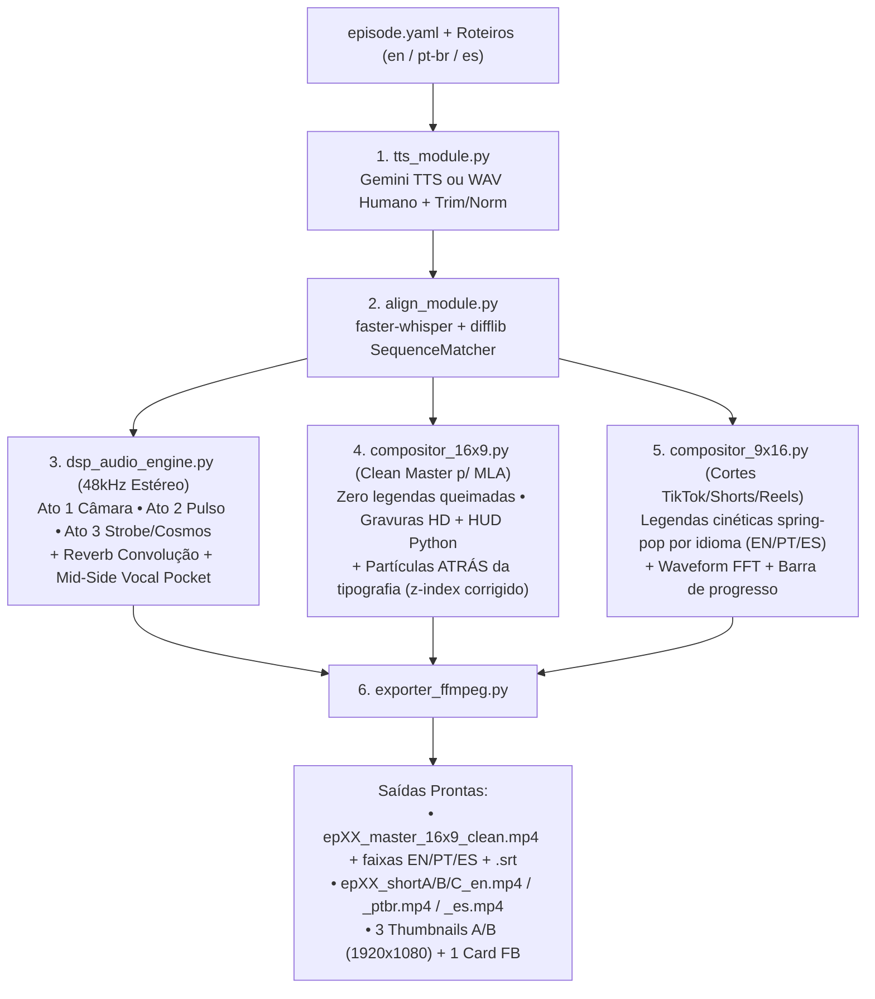

# Arquitetura do `DarkStudio Engine` — Motor Audiovisual Modular em Python

> [!IMPORTANT]
> **Por que construir esta engine antes de escalar:** Na auditoria técnica de `D:\producao_cynical` e `D:\producao_rose_grimoire`, identificamos que scripts monolíticos duplicados por episódio (`680` a `1.073` linhas cada) funcionam para protótipos, mas tornam inviável produzir documentários de `20–30 minutos` + 3 idiomas + cortes verticais em escala. O **`DarkStudio Engine`** unifica o melhor que você já construiu em um motor único, limpo e dirigido por arquivo de configuração (`episode.yaml`).

---

## 1. Visão Geral do Pipeline (1 Roteiro → Todos os Formatos & Idiomas)



---

## 2. Estrutura de Diretórios da Engine (Reutilizável em Todos os Seus Canais)

Recomenda-se criar em `D:\dark_studio_engine\` (compartilhado por **Anthroposium**, **The Rose Grimoire** e **The Cynical Oracle**, sem acoplar `.env` de um canal dentro de outro!):

```text
D:\dark_studio_engine\
├── .env                          # Credenciais centralizadas (GEMINI_API_KEY)
├── pyproject.toml                # Dependências travadas (uv / pip)
├── presets/
│   ├── anthroposium.yaml         # Paleta Grafite/Ouro/Esmeralda/Ciano, fontes Space Grotesk + IBM Plex Mono
│   ├── rose_grimoire.yaml        # Paleta Warm Heritage Esoteric, Cinzel + Montserrat
│   └── cynical_oracle.yaml       # Paleta Obsidiana/Ouro/Carmesim
├── src/
│   ├── tts.py                    # Suporte plugável: Gemini TTS (3.8-flash-tts) OU áudio humano WAV externo
│   ├── align.py                  # faster-whisper + difflib canônico + export automático de .srt (EN/PT/ES)
│   ├── dsp_audio.py              # Motor 48kHz estéreo (Karplus-Strong, cello, Strobe analog pluck, Mid-Side ducking)
│   ├── assets_loader.py          # Cache de imagens HD (Wellcome/BHL/PDB), smart-crop dinâmico e Ken Burns
│   ├── overlays.py               # Timelines, gráficos animados, diagramas moleculares, pull-quotes, CTA animado
│   ├── captions.py               # Legendas cinéticas width-safe com spring-pop e glow (só para 9:16 burned)
│   ├── render_video.py           # Pipe rawvideo -> FFmpeg (x264 CRF 18, 24/30fps, suporte a multi-thread por cena!)
│   └── thumbnails.py             # Gerador automático de 3 variações A/B (1920x1080) + card estático Facebook
└── cli.py                        # Comando único: python cli.py build D:\anthroposium\en\longos\ep01.yaml
```

---

## 3. Correções Técnicas Incorporadas Desde o Dia 1 (Lições da Auditoria)

1. **Ordem rígida de Z-Index (correção do bug de `render_teste_piloto_v2.py`):**
   - Camada 0: Cena cenográfica / gravura / B-roll com *Ken Burns* + *handheld breathing*
   - Camada 1: Vinheta cinematográfica + *god rays* + partículas bokeh com paralaxe
   - Camada 2: Painéis/HUD translúcidos, gráficos, timelines e diagramas
   - Camada 3: Tipografia, pull-quotes, cabeçalho, CTA e legendas *(SEMPRE por cima das partículas — zero sobreposição sobre letras!)*
2. **Exportação Dual Nativa para MLA:**
   - O `16:9` master para YouTube nunca queima legendas longas nem blocos de texto em um só idioma — usa dados/números/símbolos universais + exporta automaticamente `epXX_en.srt`, `epXX_ptbr.srt` e `epXX_es.srt` direto do JSON alinhado!
   - As versões `9:16` para TikTok/Reels geram 3 arquivos limpos (`_en.mp4`, `_ptbr.mp4`, `_es.mp4`) com legendas cinéticas nativas sincronizadas palavra a palavra.
3. **Renderização Escalável para Vídeos de `20–30 min`:**
   - Um vídeo `1920×1080 @ 24fps` de 25 minutos tem **36.000 frames**. Em Python single-thread com Pillow, renderizar 36k frames leva muito tempo.
   - **Solução obrigatória na engine:** renderizar **por cena/bloco em paralelo (`concurrent.futures.ProcessPoolExecutor`)** gerando segmentos `.mp4` temporários e concatenando via `ffmpeg -f concat -c copy` no final (acelera em **4x a 8x** em CPUs multi-core e permite re-renderizar apenas 1 cena alterada em segundos!).
4. **Fontes de Imagens 100% Domínio Público (Custo Zero & Zero Copyright para *Anthroposium*):**
   - **Wellcome Collection** (licença CC0 / domínio público — dezenas de milhares de gravuras médicas, anatômicas, botânicas e alquímicas em ultra-alta resolução);
   - **Biodiversity Heritage Library (BHL)** e **Kew Gardens** (pranchas botânicas centenárias HD);
   - **RCSB Protein Data Bank (PDB)** e visualizadores moleculares open-source (estruturas reais de proteínas, enzimas, alcaloides e moléculas de fármacos — zero copyright!).
